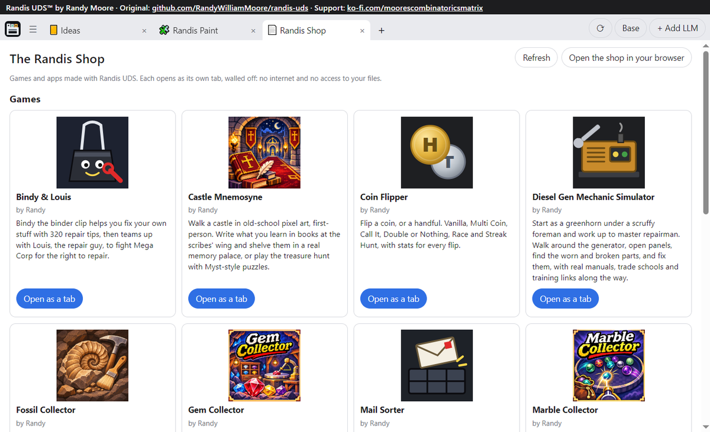

# The Randis Shop

Games and apps made with [Randis UDS](https://github.com/RandyWilliamMoore/randis-uds) by Randy Moore. Support: https://ko-fi.com/moorescombinatoricsmatrix

**[Open The Randis Shop](https://randywilliammoore.github.io/randis-shop/)**



Each item is one folder under `games/` or `apps/`. Randis UDS itself, a download rather than a page that plays here, is `software/randis-uds/`. Run `python tools/build_index.py` after changing one.

## The Jukebox

Songs made with Randis Sound Forge, free to play here and to download, royalty free, with credit: use them in anything, paid work included, with no payment or sign-up, but you must credit the song wherever you use it, with the credit line shown under it in the Jukebox (it's inside the MP3 too). The one thing you can't do is sell or hand out the songs themselves as your own music.

Each song is one folder under `music/`: `song.mp3`, `cover.jpg` and `info.json`. Every song is the same kind of file, a 192 kbps MP3 with its title, artist, album, genre, year, description, the royalty-free note and its cover art inside it. The cover is the Raisin Band dressed for the song's genre, unless you give your own. To add one (needs [ffmpeg](https://ffmpeg.org/) and pywebview):

```powershell
python tools/add_music.py "C:/path/My Song.wav" --name "My Song" --genre "Elevator Music" --blurb "Soft piano for a hotel lobby." [--cover art.png]
```

On the Jukebox's stage, the Raisin Band plays along with whatever song is on, dressed for its genre, and bounces on its beat (`site/band.js`). Randis Sound Forge and Hotdog Tycoon carry their own copy of it; after changing `site/band.js`, run `python tools/sync_band.py`.

## Share links

Every item, song and download has a **Share** button that copies a link like `https://randywilliammoore.github.io/randis-shop/share/games/blockwild/`. Pasted in Discord, it shows the item's picture card, name and blurb, and it opens the item in the shop. The header's **Share the shop** and **Share Randis UDS** copy the shop's and the app's links. `tools/build_share.py` writes the share pages (`share/`) and picture cards (`site/share/`, made with Microsoft Edge); `build_index.py` runs it for you.

## Tests

They run the real shop page in a real browser window (Edge WebView2, through pywebview), on Windows, from a test server on this computer. The window opens off screen.

```powershell
pip install pywebview
python tests/ship_test.py       # every item: listed, logo, page, Play opens the walled player, runs under its rules, every first-screen button
python tests/security_test.py   # a hostile test game tries to get out of the player; then every item still opens
python tests/link_test.py       # outside links ask first, and only "Open it" opens one
python tests/save_test.py       # files a game makes are saved by the shop page: known kinds only, one at a time
python tests/play_test.py       # real rounds of the games that have a play check
python tests/music_test.py      # Sound Forge makes elevator music; add_music.py's tags and cover; the Jukebox and its band
python tests/share_test.py      # every Share button copies the right link; every share page has the preview Discord shows
```

`ship_test.py` and `play_test.py` take item names to test only those, like `python tests/ship_test.py dice-master`. Run all seven before pushing a change to `site/`, `index.html` or `site.js`; run `ship_test.py` on any item you add or change.
